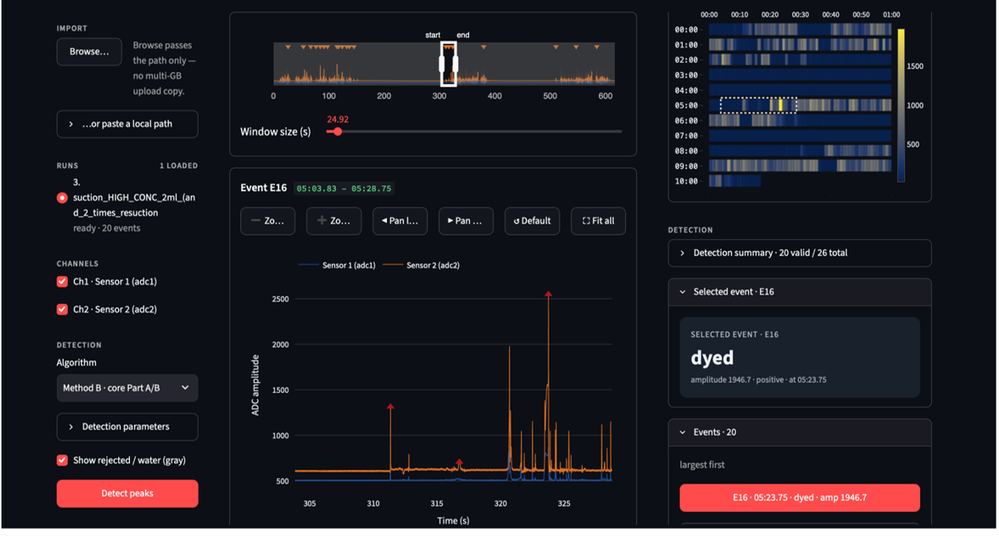

# IDP2026 group 8 — Marginum fluorescence signal

Marginum measures the fluorescence of tissue pieces while they are aspirated during surgery. This project
reads the raw two-channel recordings, finds each aspirated tissue piece, judges whether it is dyed tissue,
undyed tissue or only water, and sums up the amount of tissue. It has a command-line analysis and an
interactive viewer.



Contents: [Requirements](#requirements) · [Setup](#setup) · [Data](#data-information) ·
[How to run](#how-to-run) · [Expected result](#expected-result) · [Code structure](#code-structure) ·
[Method summary](#method-summary) · [Contributions](#contributions)

## Requirements

| | |
|---|---|
| Python | 3.11 (other 3.10+ versions are likely to work but are not tested) |
| OS | Tested on Windows 11 and macOS |
| Memory | 8 GB is enough; the 7.6 GB recording peaks at about 4.6 GB (3.6 GB main + 0.26 GB per worker) |
| Disk | Cache of about 270 MB per 4.7 h recording, in `~/.cache/idp2026` (outside the repository; safe to delete) |
| Packages | `visualizer/requirements.txt`: numpy, pandas, scipy, pybaselines, streamlit, plotly, matplotlib, pyarrow, numba |

## Setup

Run from the repository root. The one `requirements.txt` (in `visualizer/`) covers `core/`, `tools/` and
the viewer.

macOS / Linux:

```bash
git clone https://github.com/nsky-103/IDP2026_group8.git
cd IDP2026_group8
python3.11 -m venv .venv
source .venv/bin/activate
pip install -r visualizer/requirements.txt
```

Windows (PowerShell):

```powershell
git clone https://github.com/nsky-103/IDP2026_group8.git
cd IDP2026_group8
py -3.11 -m venv .venv
.venv\Scripts\activate
pip install -r visualizer/requirements.txt
```

## Data information

The recordings are **not in this repository** (data policy below). They are provided by Marginum
through the course, as the archive `2025-10-29 Suction data for tumor size estimation.7z`
(about 12 GB unpacked). Extract it anywhere outside the repository.

**Format:** CSV, a header line `adc1,adc2`, then two integer columns sampled at 50 kHz.
`adc2` is the main fluorescence channel; `adc1` is the second channel used to confirm undyed tissue.

```
adc1,adc2
510,604
499,605
```

**Known-volume recordings** (`Suction data/Original/`, from `Info on measurements.odt`):

| # | Dye concentration | Volume (ml) | Re-suctions | Size |
|---|---|---|---|---|
| 1 | HIGH | 4 | 3 | 7.6 GB, 4.7 h |
| 2 | HIGH | 4 | 2 | |
| 3 | HIGH | 2 | 2 | |
| 4 | HIGH | 1 | 2 | |
| 5 | HIGH | 1 | 0 | 30 MB, 1.2 min — **use this one for a first try** |
| 6 | MIDDLE | 3 | 0 | |
| 7 | MIDDLE | 2 | 1 | |
| 8 | MIDDLE | 1 | 0 | |
| 9 | MIDDLE | 1 | 0 | |

**Data policy:** signal files belong to Marginum / the course. Do not commit CSV, ZIP, NPY or any file
derived from them (`.gitignore` blocks the common ones). Keep data on UEF OneDrive and delete local copies
when the course ends.

## How to run

With the virtual environment activated, from the repository root:

```bash
streamlit run visualizer/app.py
```

Open http://localhost:8501 in the browser, then:

1. **Import** (left column): click **Browse…** and pick a CSV, or open *…or paste a local path* and
   paste the path → **Load**. Only the path is used, so multi-GB files are not copied.
   A rough overview appears first; the exact 1 kHz data follows in the background.
2. When the run shows *ready*: keep the algorithm `Method B · core Part A/B` → **Detect peaks**.
3. Click a piece in the events list (right column) or a heatmap cell to zoom to it. Use the window-size
   slider and the zoom / pan buttons to move around.

The same analysis can also be run without the viewer: `python tools/run_pipeline.py PATH_TO_CSV_OR_FOLDER`
(options: `python tools/run_pipeline.py --help`).

## Expected result

The screen looks like the screenshot at the top:

- **Center:** the whole recording with a marker for each piece (top), and the zoomed signal of both
  channels with the selected piece (bottom).
- **Right:** a heatmap of signal activity over time, the selected piece with its label (`dyed`,
  `solid_no_dye`, …) and amplitude, and the list of pieces, largest first.
- **Left:** the loaded run with its number of events; `water` / `undecided` pieces are shown in gray as
  rejected.

For recording 5 (the small first-try file), detection finds **10 pieces, all `dyed`**.
Number of pieces per recording for the known-volume set, to compare with (`result.json`):

| # | Pieces | `dyed` | `solid_no_dye` | `water` |
|---|---|---|---|---|
| 1 | 83 | 45 | 11 | 27 |
| 2 | 41 | 39 | 0 | 2 |
| 3 | 26 | 19 | 1 | 6 |
| 4 | 22 | 13 | 2 | 7 |
| 5 | 10 | 10 | 0 | 0 |
| 6 | 17 | 15 | 0 | 2 |
| 7 | 24 | 14 | 2 | 8 |
| 8 | 14 | 13 | 0 | 1 |
| 9 | 9 | 8 | 0 | 1 |

Loading and detection time for the largest recording (7.6 GB / 4.7 h) on a MacBook, 4 workers, numba and
pyarrow installed:

| Step | First open | Next open |
|---|---|---|
| 1. CSV -> 1 kHz | 8.4 s (row index 3.7 s + summary 4.6 s) | about 0.1 s (cache) |
| 2. Part A | 1.6 s | about 0 s (cache) |
| 3. Part B | 1.9 s | 1.9 s |
| **Total** | **12.5 s** | **2.0 s** |

## Code structure

```
core/                    data access and algorithms, no UI (details: core/README.md)
  fast_io.py             parallel CSV reading: row index, exact windows, 1 kHz summary
  preprocessing.py       Part A: filters, ALS baseline, noise level sigma
  detection.py           Part B: peaks, pieces, labels, features, amount
  pipeline.py            analyse(): runs 1 -> Part A -> Part B, with the cache
tools/
  run_pipeline.py        command-line analysis of files or folders
  benchmark_io.py        speed test of each step (writes result.json)
visualizer/              Streamlit viewer (details: visualizer/README.md)
  app.py                 page layout
  panels/                one area of the page each (import, controls, overview, detail, heatmap, events)
  detectors.py           algorithms offered in the viewer; the default calls core Part A/B
  signal_io.py, load_jobs.py   reading a recording and loading it in the background
  plots.py, lttb.py      figures and LTTB downsampling for display
  requirements.txt       dependencies of the whole project
report/                  course report (LaTeX: report.tex + sections/)
result.json              last benchmark: timings and piece counts per test recording
images/                  screenshots used in this README
```

The viewer and the command line use the same `core` code, so they give the same pieces.

## Method summary

```
viewer (visualizer/load_jobs.py, detectors.py)  or  tools/run_pipeline.py
  └─ core/pipeline.py  analyse()
       ├─ 1. open_recording()            CSV -> row index + 1 kHz summary (or read from the cache)
       ├─ 2. preprocessing.preprocess()  Part A: median -> Savitzky-Golay -> ALS baseline -> sigma
       └─ 3. detection.find_pieces()     Part B: peaks -> pieces -> labels -> features -> amount
```

### 1. Read the CSV and reduce it to 1 kHz — `core/fast_io.py`

1. `build_index()` splits the file into 1024 blocks and counts the lines of each block in parallel, so
   any row can be found by its byte position.
2. `summarize()` reads the blocks in parallel and takes the mean, min and max of every 50 samples
   (50 kHz -> 1 kHz; parsed with numba, else pyarrow, else pandas).
   - The **mean** is the input for the analysis. The signal has no content above about 500 Hz, so 1 ms
     means keep peak height (99.3–99.9%) and area.
   - **Min and max** are used to draw the whole recording without hiding narrow peaks.

### 2. Part A: clean the signal — `core/preprocessing.py`

For adc1 and adc2:

1. `clean_channel()`
   - median filter (3 samples): removes single-sample spikes
   - Savitzky-Golay filter (7 samples, order 3): smooths small wiggles but keeps the peak shape
   - minus `baseline()`: the signal is averaged to 10 Hz, `als()` (asymmetric least squares) fits a
     slow line under the peaks, and the line is interpolated back to 1 kHz
2. `quiet_sigma()`: noise level sigma = RMS of the std of the quietest 10% of 200 ms blocks.
   Idle blocks (std below half the median block std, i.e. no flow) are dropped first. Otherwise
   recordings with long idle periods get a sigma below the water wiggles, and pieces merge
   ([#3](https://github.com/nsky-103/IDP2026_group8/issues/3)).
3. `adc1_response()`: median adc1 / adc2 at the 50 largest adc2 peaks. If it is below 0.1 (as in the
   2023 test signals, where adc1 hardly responds), adc1 is not used for the two-channel check
   ([#4](https://github.com/nsky-103/IDP2026_group8/issues/4)).

### 3. Part B: find and judge the pieces — `core/detection.py`

1. **Peaks**: prominence above 10 x sigma, on adc2 and on adc1. Peaks in the first and last 0.5 s are dropped.
2. **Pieces**: peaks less than 1 s apart belong to the same piece (one aspirated tissue piece).
3. **Label**, from the largest peak of the piece:

   | Condition | Label |
   |---|---|
   | higher than the no-dye level (68.9 counts, top 0.1% of water-only peaks) | `dyed` |
   | lower, but confirmed by adc1 (two-channel check below) | `solid_no_dye` (tissue without dye) |
   | lower and not confirmed | `water` |
   | lower, and the check is not used in this recording | `undecided` |

   **Two-channel check** ([#11](https://github.com/nsky-103/IDP2026_group8/issues/11)): the piece is
   confirmed if there is an adc1 peak
   - within ±20 ms of the top adc2 peak, after shifting by the recording's channel lag, and
   - at least 5% as high as that adc2 peak (so small adc1 noise peaks do not pass by chance).

   The lag differs per recording (adc1 is 18–33 ms earlier in the 2025 known-volume recordings and
   9–14 ms later in the tumour ones), so it is measured on the dyed pieces of each recording.
   The chance rate is measured by shifting adc1 by 2–20 s. The check is not used if the chance rate is
   above 20%, or if adc1 hardly responds (Part A step 3).
4. **Features**: a piece spans from 30 ms before its first peak to 30 ms after its last peak. For each
   piece: start, end, duration, number of peaks, max height, and area (sum of the positive signal,
   counts x ms).
5. **Amount**: `amount()` adds up the area of the `dyed` and `solid_no_dye` pieces, over the whole
   recording or a time range. The area is the main measure of the amount of tissue; the number of
   pieces is for reference only, because it stops growing when pieces merge in dense suctions.

**Limitations:** there is no ml value yet, because the area per ml depends on the dye concentration and
on re-suction. The thresholds (68.9 counts, 1 s, ±20 ms) were chosen on the 2025 recordings; the analysis
behind them is summarised in [`core/README.md`](core/README.md).

## Contributions

Who did what, per file. When code is based on another member's idea, the exact lines are marked in the
file with `# ---- Idea: <name> ...` and `# ---- end of <name>'s idea`.

| Part | Files | Who |
|---|---|---|
| Visualizer app | `visualizer/` | tut-morimoto, KeitoTsubaki (see git history) |
| Fast CSV access: row index, zoomed windows, 1 kHz summary | `core/fast_io.py`, `tools/benchmark_io.py` | Sora |
| Preprocessing: median + Savitzky-Golay, ALS baseline fitted on 10 Hz block means, sigma (quietest 10% of 200 ms blocks) | `core/preprocessing.py` (marked block) | **Unmona** (idea and original code in [udgithubit/IDP](https://github.com/udgithubit/IDP), `idp/method.py`); moved into this repository by Sora |
| Peak detection, grouping into pieces (1 s), judgement (no-dye level, two-channel check), features, amount (total area) | `core/detection.py` | Sora |
| Cache of the reduced data for the next open | `core/pipeline.py` (marked block) | **Unmona** (idea, `idp/fast.py`); written by Sora |
| Cache of the Part A output ([#17](https://github.com/nsky-103/IDP2026_group8/issues/17)) | `core/pipeline.py` (`save_part_a`, `load_part_a`) | tut-morimoto |
| Dropping idle blocks before sigma (#3) | `core/preprocessing.py` (marked inside `quiet_sigma`) | Sora |
| adc1 response check, `undecided` label (#4) | `core/preprocessing.py`, `core/detection.py` | Sora |
| Pipeline and command-line runner | `core/pipeline.py`, `tools/run_pipeline.py` | Sora |

The analysis behind the values (no-dye level 68.9, 1 s gap, ±20 ms) was done by Sora outside this
repository; the results are summarised in [`core/README.md`](core/README.md).
